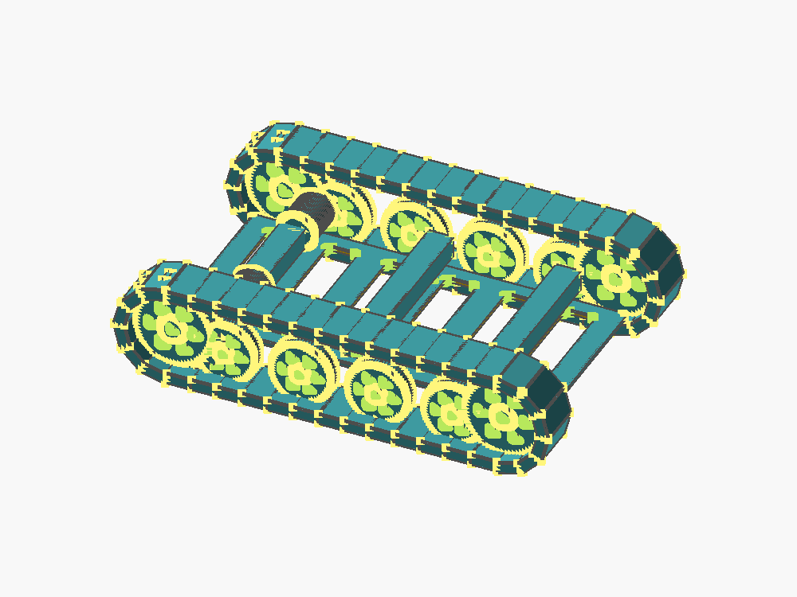
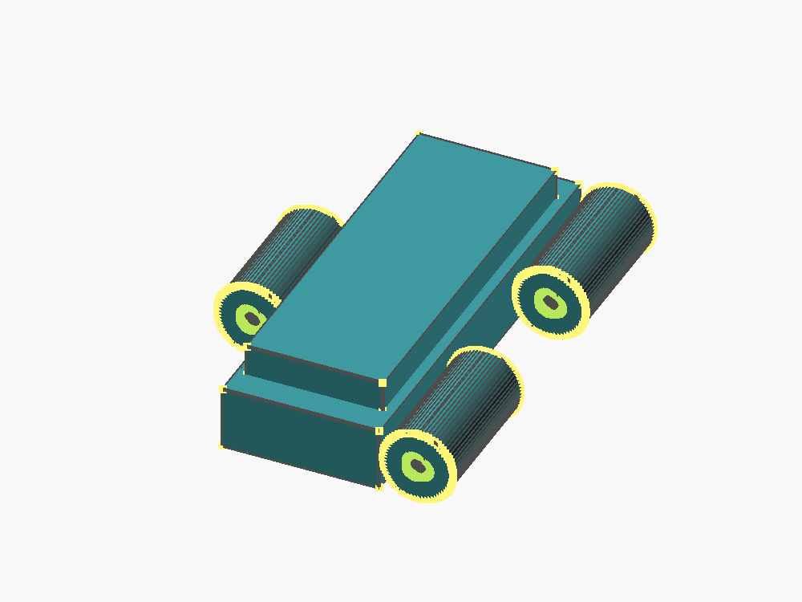
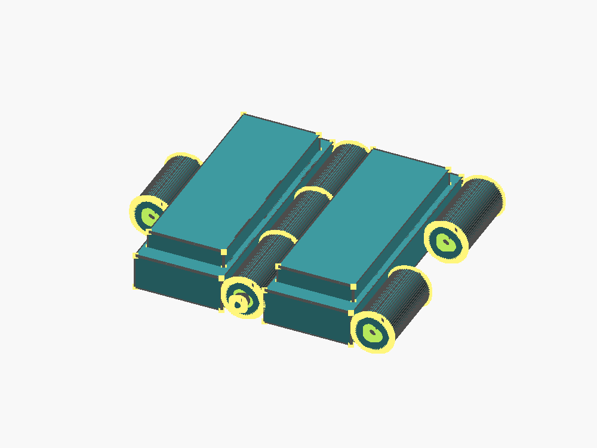

# Narrow stair tracker review

## Outcome

The 340 x 526 mm envelope is plausible for a narrow stair-climbing prototype and the parts are nominally sized for an X1C bed, but this revision is **not ready to print or build**. The actual track link is disconnected geometry, the sprocket tooth collides with the link at the nominal pitch radius, and the displayed track loop does not follow the 11-tooth pitch geometry.

## Blocking findings

### The printable link is four disconnected solids

`body_x` is 20 mm, so the pad ends 10 mm from its centre. Each 9 mm hinge barrel is centred 15 mm away and its inner edge is 10.5 mm away. That leaves a 0.5 mm air gap between the pad and every hinge barrel. The full OpenSCAD render reports five Nef volumes: the exterior volume plus four disconnected solid components.

The adjacent knuckles do align around a 3 mm pin, but the pin only joins loose barrels because none of those barrels is attached to its pad.

### The sprocket tooth does not fit the drive pocket

At nominal pitch radius, the 13 mm radial tooth extends 6.5 mm outside the hinge pitch circle. The link's inner face is 4.5 mm inside that circle, so the tooth enters the link by approximately 11 mm. The pocket is only 4.1 mm deep because its 8.4 mm cutter is centred at z=-0.1. The review fixture produces a non-empty intersection between the tooth and link.

### The displayed loop is not pitch-correct

The assembly places six simplified links around each 180-degree end, giving 30 degrees per link. An 11-tooth sprocket requires 32.727 degrees per 30 mm pitch, and the 30-degree chord is only about 27.6 mm. The assembly's 38-link estimate therefore cannot validate the real pinned track. The idler position is fixed and there is no tension adjustment to absorb a link-count or print-tolerance error.

## Other fit-to-purpose risks

- The 3.2 mm horizontal bores give a 3 mm pin only 0.2 mm diametral clearance. Expect to drill or ream them after printing.
- Knuckle side clearance is a reasonable nominal 0.35 mm per side, and the 9 mm barrel leaves about 2.9 mm radial wall around the pin bore.
- There is no pin-retention feature. Smooth rod can walk sideways during skid steering or stair impacts.
- The 55 mm track has no guide horns, while the idler and road wheels are only 14-16 mm wide and have no flanges. Derailment under lateral load is likely.
- The drive and idler axles are cantilevered outward from a single inner rail bearing. Stair impacts need an outer support or a much more explicit shaft design.
- The motor and gearbox are placeholders, so the model does not yet provide a buildable reduced brushless drivetrain.
- Hard printed grousers will have poor grip on many stair surfaces. Provide replaceable TPU contact pads.

## Recommended next prototype gate

Fix the link-to-barrel union, redesign the tooth/pocket radial engagement, make the loop pitch-correct with an adjustable idler, add lateral track guidance and pin retention, then print two links plus a six-to-eight-link sprocket wrap test before producing a full track.
