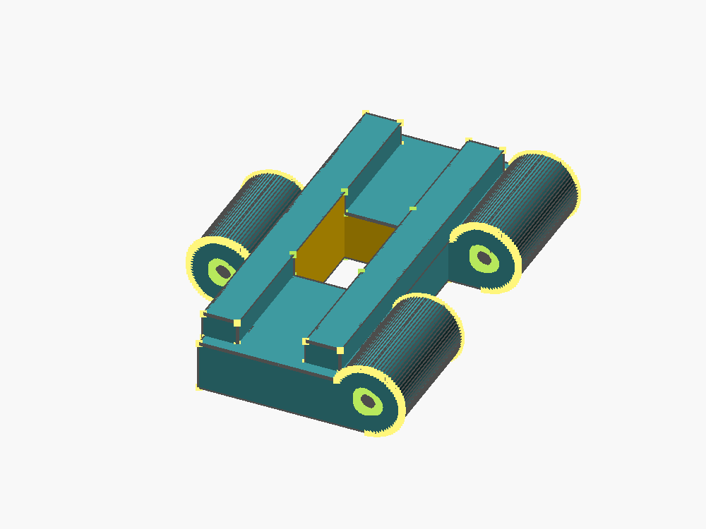
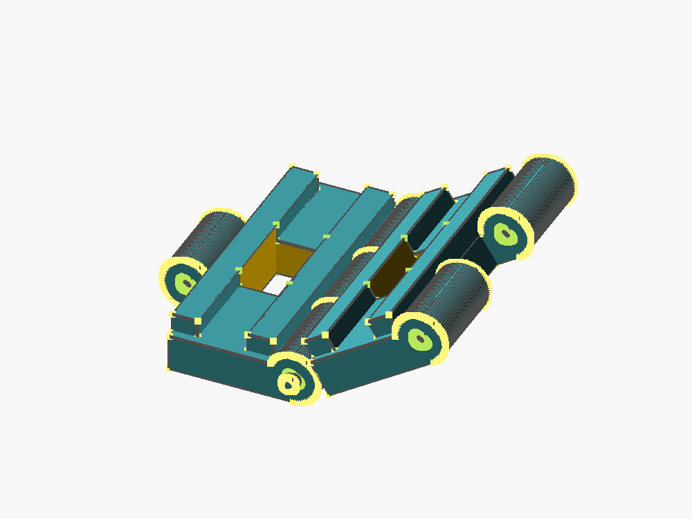
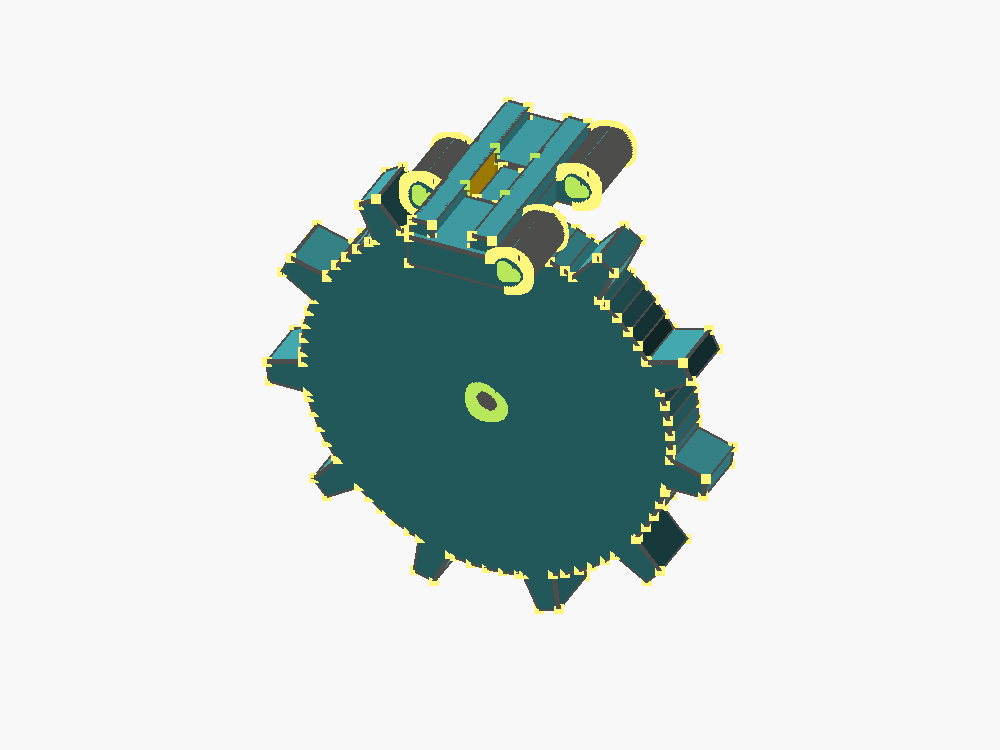

# Standalone track-link review

## Outcome

The default link passes the initial geometry gates and is ready for a two-link test print. This validates the CAD geometry, not the final material clearances or loaded durability.

## Validated geometry

- The link renders as one simple connected solid.
- Straight adjacent links have an empty intersection.
- Links bent 32.727 degrees for the 11-tooth reference cog have an empty intersection.
- The reference cog is one connected solid.
- The reference cog and engaged link are two separate solids with an empty intersection.
- The cog tooth is 8 mm wide at its root and tapers symmetrically to 5 mm at its tip, giving approximately 8.5-degree entry and exit faces for reversible drive.
- The 8 x 14 mm tooth root has 1 mm nominal clearance on all four sides inside the 10 x 16 mm drive window.
- Cog tooth roots overlap the reference wheel body by 1 mm.

## Print assumptions to verify physically

- A 3 mm pin must move freely in the 3.4 mm horizontal bore without excessive play.
- The 0.5 mm knuckle clearances must remain open after printing.
- The hinge connectors and drive-window side rails must survive repeated bending and tooth load.
- The printed pitch must remain consistent across six to eight connected links.

The reference cog is only an engagement gauge. Its hub and final tooth relief should be designed after measuring the printed links.
